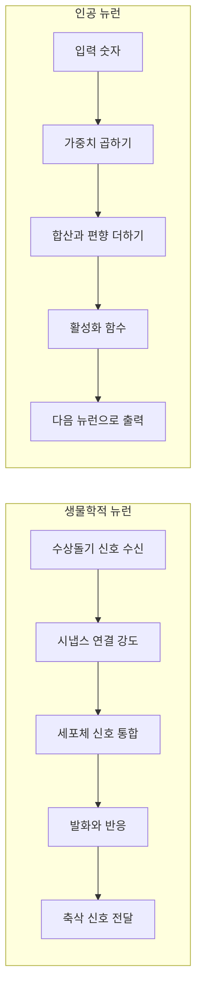
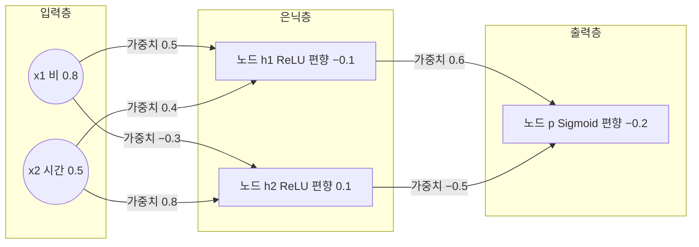
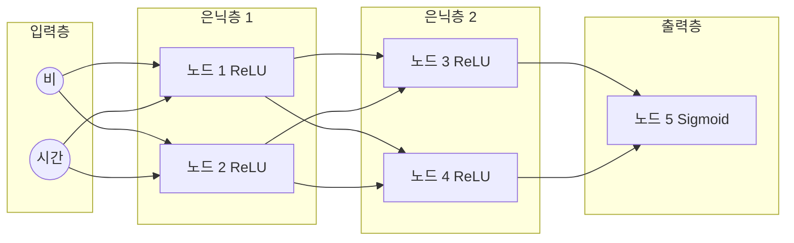
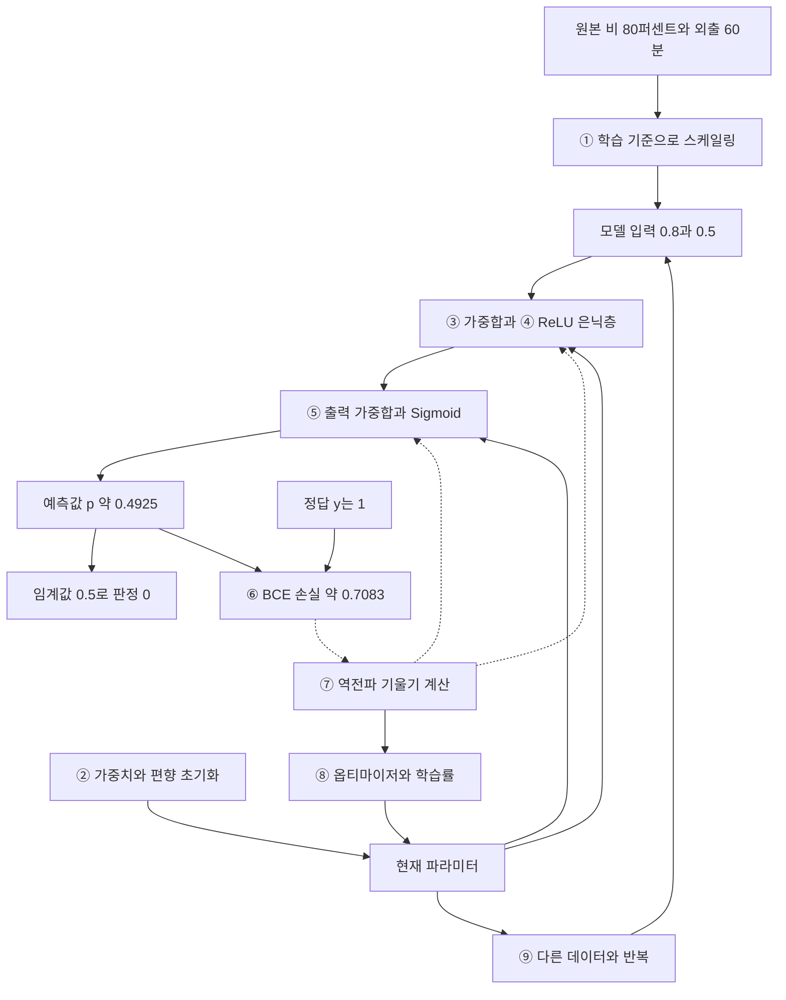

## 1 강의 조건과 종료 후 행동 목표

### 확정된 조건과 제안하는 기본값

학습 후 할 수 있어야 하는 행동은 다음 5개다.

1. AI 안에 머신러닝, 머신러닝 안에 딥러닝을 배치하고 각각에 맞는 사례를 한 가지 든다.
2. 신경망 그림에서 입력층, 은닉층, 출력층, 가중치, 편향을 가리키고 역할을 설명한다.
3. 스케일링·활성화 함수·역전파가 각각 어디서 무엇을 하는지 구분한다.
4. “순전파 → 손실 → 역전파 → 업데이트”를 자신의 말로 60초 안에 설명한다.
5. 학습 데이터와 처음 보는 평가 데이터, 학습과 추론의 차이를 설명한다.

강사가 기대하는 마지막 설명의 예:

> 먼저 입력값을 학습 때 정한 기준으로 스케일링합니다. 신경망은 가중치와 편향으로 계산하고 활성화 함수를 거쳐 예측합니다. 학습할 때는 정답과 비교해서 손실을 구하고, 역전파로 각 파라미터의 기울기를 구합니다. 옵티마이저가 학습률을 반영해 가중치와 편향을 바꿉니다. 새로운 데이터로 예측만 할 때는 보통 가중치를 바꾸지 않습니다.

## 3 단원별 교안

### 단원 A 우산 사례로 시작하기

**학습 목표:** 입력·예측·정답을 일상 상황에서 구분한다.

- S1 오늘의 질문은 신경망이 무엇을 바꾸며 배우는가이다.
- S2 비 올 확률과 외출 시간으로 우산 챙기기를 예측한다.

**일상 비유 → 동작 → 한계 → 한 문장**

우산 준비를 도와주는 수습 안내원이 지난 사례로 판단을 연습한다고 비유한다. 실제 동작은 두 숫자를 입력받아 1에 해당하는 정도를 계산하는 것이다. 안내원과 달리 신경망에 의도나 생활 경험이 있는 것은 아니며, 계산 가능한 정보만 사용한다. 한 문장으로 “입력은 판단에 쓰는 정보이고, 예측은 모델이 낸 답이며, 정답은 학습 때 비교할 기준이다.”

**그림 구성:** 왼쪽 비구름 아이콘에 ‘비 올 확률’, 시계에 ‘외출 시간’을 적고 오른쪽 ‘우산 예측기’로 연결한다. 그 오른쪽에 ‘챙기기 정도 → 0 또는 1’을 배치한다. 아직 내부 계산은 덮어 둔다.

**예제와 활동:** 80%·60분, 10%·15분을 보여주고 0·1 카드를 든다. 의견이 다른 이유를 한 사람씩 말하게 한다.

**예상 오해와 교정:** “우산 여부에는 정답이 없다.” 실제 생활에서는 취향·우산 무게·이동 경로가 영향을 준다. 이 수업에서는 한 명의 가상 담당자가 과거 상황에 붙인 권장 라벨을 정답으로 삼는다. 현실 서비스는 목적과 정답 기준부터 정해야 한다.

### 단원 B AI와 머신러닝과 딥러닝

**학습 목표:** 포함 관계, 규칙 작성과 학습, 지도·비지도·강화를 구분한다.

**슬라이드**

- S3 AI 안에 머신러닝 안에 딥러닝
- S4 사람이 작성한 규칙과 데이터로 조정하는 파라미터

**강사 설명문**

> AI는 인식·추론·언어 이해·의사결정처럼 지능이 필요한 과제를 기계로 수행하게 하는 연구와 기술의 넓은 영역입니다. 그중 데이터나 경험을 바탕으로 성능을 개선하는 방법이 머신러닝입니다. 딥러닝은 여러 처리 층을 가진 신경망으로 표현을 배우는 머신러닝의 한 갈래입니다.
>
> 우산 안내를 만드는 사람이 ‘비 올 확률 60% 이상이면 챙기기’라는 규칙을 직접 정할 수도 있습니다. 머신러닝에서는 과거의 입력과 정답을 보여주고, 계산에 쓰는 숫자인 파라미터를 학습시킵니다. 다만 사람은 문제·데이터·모델 구조·학습 기준을 여전히 정합니다.

| 범위 | 쉬운 뜻 | 사례 |
|---|---|---|
| AI | 지능이 필요한 과제를 수행하게 하는 넓은 분야 | 전문가 규칙으로 판단하는 지식 기반 시스템 |
| 머신러닝 | 데이터·경험에서 성능을 개선하는 방법 | 두 입력의 계수를 학습하는 로지스틱 회귀 |
| 딥러닝 | 여러 층의 신경망으로 표현과 예측을 학습 | 이미지에서 화염을 탐지하는 심층 신경망 |

그림은 큰 AI 원 안에 ML 원을, ML 원 안에 DL 원을 그린다. ‘모든 if문 프로그램이 AI인 것은 아님’을 아래에 짧게 적는다. 화살표로 AI가 반드시 ML로 발전한다는 인상을 주지 않는다.

| 학습 방식 | 수업용 설명 | 우산·날씨와 연결한 예 |
|---|---|---|
| 지도학습 | 입력과 정답 쌍으로 학습 | 과거 날씨·외출 시간과 우산 권장 0·1 |
| 비지도학습 | 미리 준 정답 라벨 없이 구조를 찾음 | 날씨 기록을 비슷한 유형끼리 묶기 |
| 강화학습 | 행동 후 보상을 받아 행동 전략을 학습 | 가상 환경에서 젖는 불편과 휴대 부담을 보상으로 반영 |

강화학습 예시는 실제로 이 수업에서 구현하거나 학습하는 모델이 아니다. 이후 상세 설명은 모두 지도학습이다. 세 범주가 모든 학습법을 빠짐없이 나누는 완전한 분류라고 소개하지 않는다.

**특징 학습의 차이**

‘특징’은 판단에 활용하는 정보나 표현이다. 전통적 머신러닝에서는 사람이 ‘비가 강한 시간대에 밖에 있는가’ 같은 특징을 설계하는 경우가 많다. 딥러닝은 여러 층에서 입력을 바꾸어 표현하는 방법도 함께 학습할 수 있다. 이미지에서는 초기 층의 국소 모양에서 더 복합적인 패턴으로 연결될 수 있다. 모든 노드가 반드시 사람이 이름 붙일 수 있는 의미를 갖는 것은 아니다. [S9]

**일상 비유 → 동작 → 한계 → 한 문장**

직접 작성한 우산 안내 규정과, 과거 상담 기록을 보고 판단 기준을 조정하는 안내원을 비교한다. 실제로 바뀌는 것은 가중치·편향 같은 숫자다. 학습은 사람이 전혀 개입하지 않는 과정이 아니며 ML도 특징·표현을 배울 수 있다. 한 문장으로 “딥러닝은 머신러닝의 일부이며, 여러 층에서 표현을 함께 배울 수 있지만 언제나 최선인 것은 아니다.”

**예제와 활동:** 전문가 규칙, 로지스틱 회귀, 심층 이미지 모델 카드를 포함 관계에 놓는다. “작은 표 데이터라면 더 단순한 모델도 비교해야 한다”고 덧붙인다.

**예상 오해와 교정:** ‘ML은 특징을 전혀 배우지 않는다’는 잘못된 일반화다. ‘DL이면 무조건 좋다’도 아니다. 데이터 양·구조·비용·지연·설명 필요성에 따라 선택한다.

### 단원 C AI 역사에서 무엇이 어려웠고 무엇이 달라졌는가

**학습 목표:** 용어 제안·연구 모임·다층 구조·학습법·대규모 성공을 서로 다른 사건으로 설명한다.

**슬라이드**

- S5 계산 가능한 뉴런에서 학습하는 연결까지
- S6 다층 구조와 학습 방법 그리고 데이터와 계산 자원

| 시기 | 기존에 어려웠던 점 | 변화와 강사의 설명 | 출처 |
|---|---|---|---|
| 1943 | 신경 활동을 논리적 계산으로 표현하기 | McCulloch·Pitts가 단순화한 인공 뉴런 모델을 제시. 오늘의 학습 알고리즘 전체가 탄생한 것은 아님 | S1 |
| 1955년 8월 31일 | 지능 연구를 묶을 공동 연구 의제 | McCarthy 등 4인의 제안서에 Artificial Intelligence를 사용. 용어 제안 시점 | S2 |
| 1956년 여름 | 관련 연구자들의 공동 탐구 | 다트머스 여름 연구 모임 개최. AI 연구 분야 형성의 상징적 계기 | S3 |
| 1950년대 후반 | 연결의 강도를 데이터에 맞게 바꾸기 | Rosenblatt의 퍼셉트론 연구. 본 수업의 대표 원 논문은 1958년 | S4 |
| 1960년대 초 | 단순한 구조의 표현 능력을 확장하기 | 다층 퍼셉트론 구조 연구가 이미 존재. 1962년 다층 구조 논문은 확인 가능한 사례이며 ‘최초’로 단정하지 않음 | S5 |
| 1969년 및 그 전후 | 특정 퍼셉트론 계열의 표현 한계 | Minsky·Papert의 분석. 수업에서는 원래 두 입력을 직선 하나로 나누는 단층 모델의 XOR 한계를 시연 | S6 |
| 대체로 1970년대 | 야심 찬 목표에 못 미치는 실제 성과 | 기대와 성과 차이, 탐색 계산량, 당시 자원·데이터 제약, 지원 우선순위와 연구비 변화가 맞물린 침체 | S7·S8·S22 |
| 1986년 | 은닉층 연결을 어떻게 조정할지 | Rumelhart·Hinton·Williams의 역전파 연구가 다층 표현 학습의 확산에 중요한 역할. 역전파의 수학적 아이디어가 이 해 처음 생겼다는 뜻은 아님 | S6 |
| 대체로 1980년대 후반~1990년대 초 | 전문가 시스템을 현실에서 확대·유지하기 | 규칙 획득·유지 비용과 취약성, 사업 기대와 성과의 간극 등으로 또 다른 침체. 분야와 국가에 따라 시기 차이 | S8·S23·S24 |
| 2006년 | 깊은 구조를 효과적으로 학습하기 | Hinton·Osindero·Teh의 심층 신뢰망 연구 등으로 깊은 모델 학습에 관심 재확대. 오늘의 모든 모델이 이 학습법을 쓰는 것은 아님 | S10 |
| 2012년 | 대규모 이미지 문제에서 성능·학습 시간 확보 | AlexNet에서 큰 데이터, GPU, ReLU 등을 결합해 큰 성과. 단일 아이디어만의 승리로 설명하지 않음 | S11 |
| 2014년·2017년·2020년대 | 복잡한 데이터 생성과 언어 처리의 확장 | GAN, Transformer 등 서로 다른 계열의 진전과 대규모 학습이 생성형 AI 활용 확대에 기여. 생성형 모델 자체가 2020년대에 처음 생긴 것은 아님 | S12·S13·S14 |

**강사 설명문**

> 작은 계산 장치를 여러 개 연결하면 더 복잡한 판단을 할 수 있겠다는 생각은 오래전부터 있었습니다. 하지만 구조를 그릴 수 있는 것, 그 안의 수많은 연결을 잘 학습시키는 것, 큰 실제 문제에서 비용을 감당하며 쓰는 것은 서로 다른 문제입니다. AI 역사는 한 번의 발명보다 이 조건들이 함께 갖추어지는 과정으로 보는 편이 정확합니다.
>
> 겨울이라고 해서 모든 연구가 멈춘 것은 아닙니다. 기대에 못 미친 성과와 계산·데이터·비용의 문제가 지원과 사업 기대에 영향을 주었습니다. ‘XOR를 못 풀어서 AI 전체가 끝났다’고 설명하면 여러 시대와 분야를 하나로 뭉개게 됩니다.

**일상 비유 → 동작 → 한계 → 한 문장**

우산 안내 업무를 여러 단계로 나누자는 설계, 각 단계의 교육법, 많은 상담을 처리할 시설은 각각 필요하다고 비유한다. 실제 역사는 모델 구조·학습 알고리즘·계산과 데이터·지원 환경이 상호작용했다. 역사에는 단일한 원인이나 전 세계 공통의 시작·종료일이 없다. 한 문장으로 “다층 구조의 존재, 학습법의 발전, 대규모 활용의 성공은 구분해야 한다.”

**그림 구성:** 연표의 위쪽에는 ‘구조’, 가운데 ‘학습법’, 아래 ‘데이터·계산·활용’을 배치한다. 1960년대·1986년·2012년을 각기 다른 줄에 표시한다. 겨울은 수직 단절선 대신 옅은 음영 구간으로 그린다.

**예제와 활동:** “다층 구조만 만들면 자동으로 잘 학습될까요?”에 손으로 답하게 하고, 데이터·학습법·컴퓨팅 중 한 조건을 말하게 한다.

**예상 오해와 교정:** 1955년은 제안서, 1956년은 개최다. 1986년을 다층 신경망의 최초 제안이나 역전파 개념의 유일한 기원으로 소개하지 않는다. 역사 세부 인물·선행 역전파 논문 목록은 수강생 암기 대상에서 제외한다.

### 단원 D 생물학적 뉴런에서 인공 뉴런과 층으로

**학습 목표:** 입력·가중치·가중합·활성화·출력을 대응시키고 편향을 별도로 이해한다.

**슬라이드**

- S7 생물학적 뉴런과 인공 뉴런
- S8 가중치와 편향이 있는 계산
- S9 하나의 노드에서 층으로

| 생물학적 설명 | 인공신경망에서의 대응 | 수업에서 할 말 |
|---|---|---|
| 수상돌기를 통한 신호 수신 | 입력 | 계산에 사용할 숫자를 받는다 |
| 시냅스 연결 강도 | 가중치 | 각 입력의 영향을 곱셈으로 조절한다 |
| 세포체의 신호 통합 | 가중합 | 가중치가 곱해진 입력들을 더한다 |
| 발화 여부와 반응 | 활성화 함수의 출력 | 모인 값을 정해진 함수로 변환한다 |
| 축삭을 통한 신호 전달 | 다음 뉴런으로 출력 전달 | 계산 결과를 다음 단계의 입력으로 보낸다 |

**나란히 배치할 그림**



생물 뉴런 왼쪽 그림은 실제 형태를 단순하게 그려 위 표의 부위 이름을 붙인다. 위 흐름도는 기능의 대응을 보여주기 위한 것으로 실제 해부학적 위치나 신호 시간 순서를 그대로 복제한 것은 아니다.

**강사 설명문**

> 인공신경망은 뇌에서 일부 아이디어를 얻었지만 실제 뇌를 그대로 복제한 장치는 아닙니다. 오늘은 ‘여러 신호를 받고, 영향을 조절하고, 모아서 반응하고, 다음 단계로 보낸다’는 대응만 가져오겠습니다.
>
> 가중치는 각 정보의 영향력을 조절하는 숫자입니다. 양수이면 그 뉴런의 점수를 올리는 쪽으로, 음수이면 내리는 쪽으로 작용할 수 있습니다. 편향은 정보마다 곱하는 값이 아니라 마지막에 더하는 값입니다. 같은 입력에서도 반응하기 쉬운 정도를 옮기는 조절값이라고 생각하세요.

**일상 비유 → 동작 → 한계 → 한 문장**

우산 안내원이 비 올 확률과 외출 시간을 서로 다른 비중으로 반영한다고 비유한다. 실제 계산은 ‘입력×가중치’를 더하고 편향을 더한 뒤 활성화 함수를 적용한다. 음수 가중치도 가능하고, 큰 절댓값만으로 원본 특징의 전반적 중요도나 인과관계를 단정할 수 없다. 한 문장으로 “노드는 입력을 가중합하고 편향과 활성화 함수를 거쳐 출력을 만드는 계산 단위다.”

**수식과 숫자 예제**

`z = w₁×x₁ + w₂×x₂ + b`

- x₁·x₂: 입력 2개. w₁·w₂: 각 연결의 가중치. b: 편향. z: 활성화 함수 적용 전 값.
- 입력 0.8·0.5, 가중치 0.5·0.4, 편향 −0.1이면 z=0.5×0.8+0.4×0.5−0.1=0.5.
- ReLU를 적용한 출력 h는 0.5다. h는 이 은닉 뉴런의 출력이라는 이름이다.

**그림 구성:** 원을 노드, 같은 단계의 원 묶음을 층, 원 사이 화살표를 연결로 표시한다. 가중치는 화살표에, 편향은 계산하는 노드 안이나 옆에 쓴다. 입력층은 값을 받아 전달하는 곳으로, 이 예시에서는 편향·활성화 계산이 없다고 설명한다.

**참여 활동:** 0.5×0.8과 0.4×0.5를 각각 계산한 뒤 −0.1을 더한다. 결과가 음수라면 ReLU 뒤에는 무엇이 남는지도 묻는다.

**예상 오해와 교정:** 편향을 ‘세포의 어느 부위’에 억지로 대응하지 않는다. 노드 하나가 현실의 개념 하나를 반드시 뜻하지도 않는다. 실제 뇌의 복잡한 시간 변화·화학 작용·학습 방식은 이 단순 대응에 포함하지 않는다.

### 단원 E XOR로 은닉층과 비선형성을 이해하기

**학습 목표:** 단층 모델의 한계와 비선형 중간 표현의 역할을 설명한다.

**슬라이드**

- S10 두 입력이 다를 때만 1인 XOR
- S11 직선 하나로 나눌 수 없는 네 점
- S12 은닉층과 비선형 변환이 만드는 중간 표현

XOR는 ‘두 신호 중 정확히 하나만 1이면 출력이 1’인 규칙이다. 주 사례인 우산 모델과는 다른, 표현 능력을 확인하는 15분짜리 보조 활동이다.

| 입력 a | 입력 b | XOR 정답 |
|---:|---:|---:|
| 0 | 0 | 0 |
| 0 | 1 | 1 |
| 1 | 0 | 1 |
| 1 | 1 | 0 |

**강사 설명문**

> 좌표 네 모서리에 점을 찍겠습니다. 대각선 두 점은 0이고 반대 대각선 두 점은 1입니다. 직선 하나로 0과 1을 양쪽으로 완벽하게 나눠 보세요. 어느 쪽으로 그어도 실패합니다. 원래 두 입력의 가중합을 임계값과 비교하는 단층 퍼셉트론은 이런 방식으로 경계를 만들기 때문에 이 문제를 풀 수 없습니다.
>
> 중간에 다른 계산을 만들어 조합하면 어떨까요? ‘하나 이상 켜짐’과 ‘둘 다 켜짐’을 따로 계산한 뒤 조합하면 두 입력이 다른 경우를 구별할 수 있습니다. 은닉층은 이렇게 입력을 다른 표현으로 바꾸는 공간이 될 수 있습니다.

**그림 구성:** 가로축 a, 세로축 b인 정사각형에 네 점을 찍는다. (0,0)·(1,1)은 속이 빈 원, (0,1)·(1,0)은 채운 원으로 그린다. 색만으로 구별하지 않는다. 오른쪽에 입력 2개 → 중간 신호 2개 → 출력 1개를 배치한다.

**ReLU로 실제 가능한 간단한 예제**

- 첫 중간 신호 u=ReLU(a+b).
- 두 번째 중간 신호 v=ReLU(a+b−1).
- t=u−2v로 합친다. a·b·u·v·t는 이 XOR 활동에서만 쓰는 기호다.

| a,b | u | v | t=u−2v |
|---|---:|---:|---:|
| 0,0 | 0 | 0 | 0 |
| 0,1 | 1 | 0 | 1 |
| 1,0 | 1 | 0 | 1 |
| 1,1 | 2 | 1 | 0 |

최종 이진 판정은 t≥0.5이면 1로 정하면 된다. 이 그림의 마지막은 설명용 합산·판정이며, 뒤에 나오는 우산 모델의 Sigmoid 출력과 구별한다. 필요하면 Sigmoid에 10t−5를 넣어 같은 0.5 판정으로 연결할 수 있지만 본 수업에서는 생략한다. 위 가중치는 가능한 표현을 보여주기 위해 사람이 정한 값이지, 학습 결과라고 주장하지 않는다.

**활성화 함수가 없다면**

중간 계산이 ‘두 배 한 뒤 1 더하기’이고 다음 계산이 ‘세 배 한 뒤 2 더하기’라면 전체는 ‘여섯 배 한 뒤 5 더하기’로 합쳐진다. x는 처음 숫자다.

`x → 2x+1 → 3(2x+1)+2 = 6x+5`

여러 입력에서도 가중합과 편향만 반복하면 하나의 아핀 변환으로 합쳐진다. 입문에서는 흔히 선형 계산이라고 부르지만 편향까지 포함한 엄밀한 이름은 아핀 변환이다. 마지막에 Sigmoid 하나만 붙여도 이진 분류의 0.5 경계는 여전히 직선이라 원래 XOR를 해결하지 못한다. 은닉층의 비선형성이 핵심이다.

**일상 비유 → 동작 → 한계 → 한 문장**

같은 우산 점수를 계속 일정 비율로 확대하고 더하기만 하면 중간 단계를 줄여 쓸 수 있다고 비유한다. ReLU처럼 일부 구간을 다르게 처리하면 합치기 어려운 새로운 관계를 만든다. 비선형 함수를 넣는 것만으로 모든 문제가 학습되거나 일반화되는 것은 아니다. 한 문장으로 “은닉층의 비선형 변환은 단층의 직선 경계로 표현하기 어려운 관계를 조합하게 해준다.”

**활동:** 3분 동안 네 점을 직선 하나로 나누게 하고, 2분 동안 ‘둘 다 켜진 경우’의 중간 신호를 확인한다.

**예상 오해와 교정:** 단층은 여기서 ‘원래 두 입력의 선형 결합으로 바로 판정하는 모델’이다. 이미 비선형 특징을 사람이 제공한 다른 모델까지 못 푼다는 뜻은 아니다. 깊이만 늘리고 활성화 함수를 빼면 해결되지 않는다.

### 단원 F 스케일링은 신경망에 들어가기 전의 준비

**학습 목표:** 위치, 목적, Min-Max·표준화, 학습 기준 재사용을 구분한다.

**슬라이드**

- S13 원본 데이터와 모델 입력은 다를 수 있다
- S14 학습 데이터에서 정한 변환 기준을 계속 사용한다

**용어 정의:** 이번 교안의 ‘입력 정규화’는 Min-Max처럼 입력 범위를 조정하는 뜻으로 한정한다. 스케일링은 더 넓게 값의 크기와 범위를 조절하는 전처리를 가리킨다. 표준화도 스케일링의 한 방법이다. 정규화라는 말은 벡터 길이 조정이나 신경망 내부 계층에도 쓰이므로 기법 이름을 함께 말한다. 과적합을 줄이는 regularization은 보통 ‘규제’라 하며 여기의 입력 스케일링과 구분한다.

**강사 설명문**

> 외출 시간을 분으로 쓰면 60이고 시간으로 쓰면 1입니다. 똑같은 상황인데 숫자 크기는 달라집니다. 숫자가 크다는 이유만으로 중요한 정보라고 볼 수 없겠죠. 입력 범위가 크게 다르면 신경망을 최적화할 때 균형 있게 값을 조정하기 어려워질 수 있어서 스케일을 맞춥니다.
>
> 원본을 지우는 것이 아닙니다. 원본에서 변환한 값을 모델에 전달합니다. 모델 입력이라고 부르는 값은 이미 전처리된 숫자일 수 있습니다.

**그림 구성:** ‘원본 80%·60분’ → ‘전처리 Min-Max’ → ‘입력 0.8·0.5’ → ‘신경망’ 순서로 배치한다. 학습 데이터에서 얻은 기준 상자를 전처리로 연결하고, 평가·새 입력도 같은 전처리를 거치게 그린다.

**Min-Max 계산**

`변환값 = (원래값 − 학습 최솟값) ÷ (학습 최댓값 − 학습 최솟값)`

교재의 가상 학습 데이터 전체에서 비 올 확률은 최소 0·최대 100%, 외출 시간은 최소 0·최대 120분이라고 가정한다. 실제 데이터가 이 범위를 갖는다는 주장이 아니다.

- 80% → (80−0)/(100−0)=0.8.
- 60분 → (60−0)/(120−0)=0.5.
- 처음 보는 180분 → (180−0)/(120−0)=1.5. 학습 범위 밖이면 결과가 1보다 클 수 있다. 임의로 새 최댓값 180으로 다시 계산하지 않는다.

**표준화 비교**

`변환값 = (원래값 − 학습 평균) ÷ 학습 표준편차`

평균은 중심값, 표준편차는 값들이 평균 주변에 얼마나 퍼졌는지 나타내는 크기다. 다음은 주 모델과 분리한 비교용 숫자 세트다. 로그·제곱근 계산은 요구하지 않는다.

| 비교 항목 | Min-Max | 표준화 |
|---|---|---|
| 비교 데이터 | 0, 0, 20, 20 | 0, 0, 20, 20 |
| 학습한 기준 | 최소 0, 최대 20 | 평균 10, 표준편차 10 |
| 값 0의 변환 | 0 | −1 |
| 값 20의 변환 | 1 | 1 |
| 새 값 15의 변환 | 0.75 | 0.5 |
| 해석 | 관측 범위의 어디쯤인가 | 평균에서 표준편차 몇 개만큼 떨어졌는가 |

표준편차 10은 네 자료 전체를 기준으로, 평균에서 거리의 제곱을 평균 내는 분모 4의 정의를 사용한 결과다. 표본 표준편차의 분모 3을 쓰는 계산과 혼동하지 않는다. 표준화가 데이터를 자동으로 정규분포로 바꾸거나 0~1로 제한하는 것은 아니다. [S15·S16]

**일상 비유 → 동작 → 한계 → 한 문장**

우산 안내원이 서로 다른 단위의 기록을 같은 기준표로 정리해 받는다고 비유한다. 실제로는 특징별 최소·최대나 평균·표준편차를 학습 데이터에서 구하고 입력을 변환한다. 변환은 새로운 정보를 만들지 않으며 성능 향상을 보장하지 않는다. 이상치와 모델 종류에 따라 적합한 방법이 달라진다. 한 문장으로 “학습 데이터로 정한 변환 기준을 평가와 새 입력에도 그대로 적용한다.”

**Batch Normalization과 구분:** 입력 스케일링은 이 예시에서 모델 앞의 전처리다. Batch Normalization은 신경망 안에서 중간 값을 정규화하는 계층이며 학습 시 배치 통계, 일반적인 추론 시 누적 통계 등을 사용한다. 학습을 원활하게 돕는다는 관련성은 있지만 같은 위치의 동일한 처리도, 모든 모델의 필수 단계도 아니다. ‘내부 분포 변화 감소가 유일하게 확정된 효과 원인’이라고 단정하지 않는다. [S17]

**활동:** 비 80%·외출 60분을 직접 변환하고 그림의 ‘전처리’에 붙인다. 평가 데이터 자체에서 평균을 다시 구하면 왜 좌표 기준이 달라지는지 짝에게 설명한다.

**예상 오해와 교정:** 평가 데이터로 기준을 학습하면 평가 정보가 학습 절차에 섞이는 데이터 누수가 생길 수 있다. 최댓값=최솟값이거나 표준편차 0인 특징은 나눗셈 예외를 처리해야 한다. 그 처리는 강사용 보충 설명으로만 다룬다.

### 단원 G 작은 신경망과 순전파

**학습 목표:** 2→2→1 구조에서 예측을 얻고 활성화 함수의 위치를 설명한다.

**슬라이드**

- S15 우산 모델의 입력과 정답
- S16 연결의 초기 숫자
- S17 가중합과 ReLU
- S18 Sigmoid의 연속 출력과 최종 판정

**자료 예시**

| 용도 | 비 올 확률 | 외출 시간 | 담당자가 붙인 우산 권장 정답 |
|---|---:|---:|---:|
| 학습 카드 A | 80% | 60분 | 1 |
| 학습 카드 B | 10% | 15분 | 0 |
| 학습 카드 C | 30% | 120분 | 1 |
| 학습 카드 D | 0% | 0분 | 0 |
| 학습 카드 E | 100% | 120분 | 1 |
| 평가 카드 F | 70% | 45분 | 1 |
| 평가 카드 G | 15% | 10분 | 0 |

카드 F·G는 학습과 기준 선택에 사용하지 않고 마지막에 처음 공개한다. 실제 모델 학습에 충분한 데이터 양이라는 뜻은 아니다. 하이퍼파라미터를 고를 필요가 있으면 학습/검증/최종 테스트를 더 분리해야 하며, 오늘은 학습과 평가의 두 역할만 먼저 익힌다.

**구조 그림**



노드는 계산 단위이고, 층은 같은 단계의 노드 묶음이다. 은닉층은 정답 라벨이 직접 붙어 있지 않은 중간 표현을 계산한다. 이 예시에서는 은닉 노드별로 ‘비 담당’·‘시간 담당’이라는 의미를 확정하지 않는다. 입력층을 층 수에 포함하는 관례에 차이가 있으므로 ‘입력 2·은닉 2·출력 1’로 말한다.

이 모델은 **은닉층이 하나인 작은 신경망**이라고 부른다. ‘깊다’의 층 수 기준에는 문맥 차이가 있으며 이 구조를 전형적인 깊은 신경망이라고 단정하지 않는다.

**초기화 설명**

> 아직 학습하지 않았으므로 연결마다 출발 숫자가 필요합니다. 이를 초기화라고 합니다. 실제로는 층 크기와 활성화 함수에 맞는 무작위 초기화를 많이 사용합니다. 오늘은 계산을 따라가기 좋게 서로 다른 값을 지정했습니다. 아래 숫자는 학습으로 얻은 최적값이 아닙니다.

가중치를 전부 똑같이 시작하면 같은 층의 뉴런들이 같은 역할로 움직일 수 있다. 편향은 0으로 시작할 수도 있다. ‘모든 숫자는 반드시 0이 아닌 무작위여야 한다’고 가르치지 않는다.

**활성화 함수 두 가지**

| 함수 | 쉬운 동작 | 입력값 예 | 출력값 예 | 이 모델에서 위치 |
|---|---|---|---|---|
| ReLU | 음수는 0, 양수는 그대로 | −2, 0, 0.5, 2 | 0, 0, 0.5, 2 | 은닉층 |
| Sigmoid | 숫자를 부드럽게 0과 1 사이로 변환 | −2, 0, 2 | 약 0.1192, 0.5, 0.8808 | 출력층 |

ReLU는 여러 구간을 다르게 처리하는 비선형 함수이고 계산이 간단하다. Sigmoid는 이진 분류에서 1인 경우의 확률 추정값으로 해석할 출력을 만들기 좋다. 확률 추정의 실제 신뢰도가 자동 보장되는 것은 아니다. 두 함수가 모든 문제에 정답인 조합도 아니다. [S18·S19]

**슬라이드에 넣을 간단한 그래프**

```mermaid
xychart-beta
  title "ReLU 입력과 출력"
  x-axis "입력 z" [-2,-1,0,1,2]
  y-axis "출력" 0 --> 2
  line [0,0,0,1,2]
```

```mermaid
xychart-beta
  title "Sigmoid의 대표 점"
  x-axis "입력 z" [-6,-4,-2,0,2,4,6]
  y-axis "출력" 0 --> 1
  line [0.0025,0.0180,0.1192,0.5,0.8808,0.9820,0.9975]
```

Sigmoid 그래프는 대표 점을 이은 근사 그림이다. 슬라이드에서는 점들을 지나는 매끈한 S자 곡선으로 그리고 양끝이 0과 1에 가까워짐을 보여준다. ReLU는 음수 부분 수평선과 양수 부분 기울기 1인 직선이 0에서 만난다. 가로축은 함수에 들어가는 가중합 값, 세로축은 함수 출력이다.

**같은 사례로 순전파 계산**

1. 원본 입력 80%·60분을 전처리하여 x₁=0.8, x₂=0.5로 만든다.
2. 첫 은닉 노드의 가중합 z₁=0.5×0.8+0.4×0.5−0.1=0.5.
3. h₁=ReLU(z₁)=0.5.
4. 둘째 은닉 노드의 가중합 z₂=−0.3×0.8+0.8×0.5+0.1=0.26.
5. h₂=ReLU(z₂)=0.26.
6. 출력 노드의 활성화 전 값 a=0.6×0.5−0.5×0.26−0.2=−0.03.
7. p=Sigmoid(a)≈0.4925. 함수의 복잡한 계산은 강사가 제공한다.
8. 최종 판정 기준을 p≥0.5이면 1로 정했다면 이번 판정은 0이다. 정답 1과 다르다.

z₁·z₂는 은닉층 활성화 전 값, h₁·h₂는 은닉층 출력, a는 출력층 활성화 전 값, p는 1에 대한 예측값이다. Sigmoid 계산 공식은 본 수업에서 외우지 않는다. 강사용으로 `Sigmoid(a)=1/(1+exp(−a))`이며 exp는 자연상수 e를 밑으로 하는 지수 함수다.

**강사 설명문**

> 입력에서 출력 쪽으로 계산해서 예측을 얻는 이 흐름이 순전파입니다. 중간 노드마다 먼저 곱하고 더한 뒤 활성화 함수를 적용했습니다. 활성화 함수가 역전파 때만 쓰이는 것이 아니라 지금 예측을 만들 때 이미 쓰인다는 점을 봐주세요.
>
> 0.4925는 출력값이고, 0은 기준 0.5를 적용해 내린 판정입니다. 둘은 다른 단계입니다. 학습할 때는 딱 잘라 만든 0 대신 연속적인 출력값을 손실 계산에 사용합니다.

**일상 비유 → 동작 → 한계 → 한 문장**

우산 안내의 중간 점수들을 조합한 뒤 최종 권장 정도를 만드는 흐름으로 비유한다. 실제로 은닉층에는 ReLU, 출력층에는 Sigmoid를 적용한다. ReLU를 ‘켜지면 무조건 1’인 스위치로 설명하면 잘못이다. 2를 넣으면 2가 나오며 출력 범위의 상한도 1이 아니다. 한 문장으로 “활성화 함수는 순전파에서 값을 비선형으로 바꾸고, 학습에서는 그 미분이 기울기 계산에 관여한다.”

**활동:** 수강생은 첫 은닉 노드 계산을 하고 나머지는 강사 계산표로 확인한다. p=0.49와 0.51의 출력값·최종 판정을 따로 말하게 한다.

**예상 오해와 교정:** 0.5는 이번 수업에서 정한 판정 기준이다. 실제 목적과 오탐·미탐 비용에 따라 검증 데이터로 다른 임계값을 정할 수 있다. 임계값을 바꾸는 것은 가중치를 학습하는 것과 다르다.

### 단원 H 정답과 비교해 손실 계산하기

**학습 목표:** 오차·손실·최종 이진 판정을 구별한다.

**슬라이드:** S19 정답과 예측의 차이를 학습에 쓸 숫자로 바꾼다.

**강사 설명문**

> 예측이 정답에서 얼마나 벗어났는지 학습에 쓸 숫자로 나타낸 것이 손실입니다. 먼저 단순한 수치 예측만 잠깐 보겠습니다. 외출 시간이 실제 60분인데 50분이라고 예측했다면 예측−정답은 −10분입니다. 그 차이를 제곱한 손실은 100입니다. 반대로 70분이라 예측해도 차이는 +10분, 제곱 손실은 똑같이 100입니다.
>
> 이것은 손실의 직관을 위한 별도 예제입니다. 지금 우산 모델은 0·1을 분류하므로 실제 계산에는 이진 교차 엔트로피라는 다른 손실을 사용하겠습니다. 이름은 길지만 정답 쪽에 작은 값을 주면 손실이 커지고, 정답 쪽에 큰 값을 주면 작아집니다.

**실제 우산 모델의 손실**

BCE는 Binary Cross Entropy, 이진 교차 엔트로피다. 정답 y=1이면 손실 L=−ln(p), 정답 y=0이면 L=−ln(1−p)다. y는 실제 정답, p는 예측값, L은 손실, ln은 자연로그다. 자연로그 손계산은 하지 않으며 아래 값을 제공한다. [S20]

| 정답 y | 예측값 p | BCE 손실 | 말로 설명 |
|---:|---:|---:|---|
| 1 | 0.9 | 약 0.1054 | 정답 쪽에 큰 값을 주어 손실 작음 |
| 1 | 0.6 | 약 0.5108 | 방향은 맞지만 덜 확신함 |
| 1 | 0.1 | 약 2.3026 | 정답 반대쪽을 강하게 예측하여 손실 큼 |
| 1 | 0.4925 | 약 0.7083 | 지금 우산 모델의 첫 결과 |

**일상 비유 → 동작 → 한계 → 한 문장**

우산 안내 연습의 피드백 점수라고 비유한다. 실제로 예측과 정답을 손실 함수에 넣어 하나의 숫자를 얻는다. 단순히 틀린 건수를 세는 정확도나 분 단위 오차와 같은 숫자는 아니다. 한 문장으로 “손실은 예측과 정답을 비교해 파라미터 조정의 기준으로 만드는 숫자다.”

**그림 구성:** 출력 p와 정답 y가 두 화살표로 손실 계산 상자에 모이게 한다. 임계값 판정은 p에서 갈라지는 별도 가지로 그려, 0·1 판정 뒤로 역전파하는 인상을 피한다.

**활동:** 정답 1일 때 p=0.9·0.6·0.1의 손실을 작은 순서로 놓는다. 모두 0·1 판정만 보면 놓치는 차이가 무엇인지 묻는다.

**예상 오해와 교정:** `예측−정답`이라는 차이와, BCE처럼 정의한 손실은 구분한다. 손실 값이 0.7이라고 해서 ‘70% 틀렸다’는 뜻도 아니다. 학습 손실 감소가 새 데이터 성능 향상을 자동 보장하지 않는다.

### 단원 I 역전파와 옵티마이저 업데이트

**학습 목표:** 기울기 계산과 실제 수정을 구분하고 부호에 따른 수정 방향을 설명한다.

**슬라이드**

- S20 각 숫자가 손실에 미치는 영향을 거꾸로 계산한다
- S21 기울기와 학습률로 가중치와 편향을 바꾼다

**강사 설명문**

> 이제 정답과 비교한 손실이 생겼습니다. 어느 연결을 어느 방향으로 고칠지 알아야 합니다. 기울기는 ‘이 숫자를 아주 조금 바꾸면, 다른 값이 현재 상태일 때 손실이 어느 방향으로 얼마나 달라지는가’를 나타냅니다. 역전파는 출력에서 앞쪽으로 계산 관계를 따라가며 이 기울기를 효율적으로 구하는 과정입니다.
>
> 역전파가 끝나면 수정 안내가 생긴 것이지, 아직 숫자를 바꾼 것은 아닙니다. 옵티마이저라는 갱신 방법이 기울기를 받아 실제 숫자를 바꿉니다. 오늘은 가장 단순한 경사하강 업데이트를 사용합니다. 학습률은 한 번에 얼마나 움직일지 조절하는 크기입니다.

**연쇄법칙의 직관**

우산 모델에서 첫 입력 연결을 조금 바꾸면 은닉 노드 출력이 바뀌고, 그 영향이 출력 노드에 이어지고, 예측이 바뀌어 손실이 바뀐다. 각 단계의 영향이 연결되므로 뒤에서 앞으로 추적할 수 있다. 한 파라미터가 여러 경로로 영향을 주면 그 경로의 기여를 합친다. 연쇄법칙은 이 연결을 계산하는 규칙이며, 초보자에게 모든 미분 공식을 전개할 필요는 없다.

**그림 구성:** 순전파 실선은 입력 → 은닉 → 출력으로 둔다. 점선은 손실 → 출력 계산 → 은닉 계산으로 되돌린다. 점선에는 ‘입력을 거꾸로 예측’이 아니라 ‘기울기 계산’을 쓴다. 별도 ‘옵티마이저’ 상자에서 각 연결의 가중치와 노드의 편향으로 ‘새 값 적용’ 화살표를 연결한다.

**대표 가중치 하나의 실제 업데이트**

대표 가중치는 첫 은닉 노드 h₁에서 출력으로 가는 v₁=0.6이다. v₁은 이 연결을 구별하는 이름이다. 이 사례에서 역전파로 얻은 손실의 기울기는 약 −0.25375다.

`새 가중치 = 기존 가중치 − 학습률 × 손실의 기울기`

- 기존 가중치 0.6.
- 학습률 0.1.
- 기울기 −0.25375.
- 새 가중치=0.6−0.1×(−0.25375)=0.625375.

기울기가 음수이므로 가중치를 올리는 쪽으로 움직인다. 이 연결 하나만 바꾸고 나머지를 고정해서 다시 순전파하면 p는 약 0.495672, 손실은 약 0.701841이 된다. 처음의 p≈0.492501·손실≈0.708260보다 이번 학습 사례의 손실이 조금 작아졌다. 다만 최종 0·1 판정은 아직 0이다.

| 같은 기존값 0.6, 학습률 0.1 | 업데이트 계산 | 새 값 | 방향 |
|---|---|---:|---|
| 기울기 +0.2인 별도 부호 예 | 0.6−0.1×0.2 | 0.58 | 감소 |
| 기울기 −0.2인 별도 부호 예 | 0.6−0.1×(−0.2) | 0.62 | 증가 |

위 ±0.2는 방향 연습용 숫자이며 실제 우산 모델의 기울기와 혼동하지 않는다. 기울기는 현재 위치 부근의 변화 정보이므로 너무 큰 보폭에서는 손실이 오를 수도 있다. [S21]

**일상 비유 → 동작 → 한계 → 한 문장**

우산 안내 훈련에서 ‘각 기준 숫자를 바꾸면 결과가 어떻게 달라질지 적은 수정 안내’가 역전파 결과이고, 그 안내를 보고 기준표를 수정하는 절차가 옵티마이저라고 비유한다. 실제로는 계산 그래프의 미분을 연결해 기울기를 구하고 업데이트한다. 사람처럼 잘못을 이해하거나 원인을 인과적으로 깨닫는 과정이라는 뜻은 아니다. 한 문장으로 “역전파는 기울기를 구하고, 옵티마이저는 학습률을 반영해 파라미터를 수정한다.”

**활동:** 계산표에서 −0.25375에 밑줄을 긋고 새 값이 커질지 먼저 예상한 뒤 계산한다. ‘편향도 학습될까’에 답하게 한다. 정답은 그렇다.

**예상 오해와 교정:** 보통 한 번의 역전파에서 학습 대상인 모든 가중치·편향의 기울기를 구한 다음 같은 업데이트 단계에서 함께 바꾼다. 위의 한 연결 수정은 이해를 위한 확대 장면이다. 전체를 동시에 수정한 실제 수치는 부록에 있다. 일부 값을 고정한 학습에서는 고정한 파라미터를 수정하지 않는다.

### 단원 J 반복 학습과 일반화와 추론

**학습 목표:** 한 번의 수정·여러 데이터의 반복·처음 보는 데이터 평가를 구별한다.

**슬라이드:** S22 배운 사례를 맞히는 것과 새 사례를 맞히는 것은 다르다.

**강사 설명문**

> 한 사례에서 손실이 줄어도 다른 상황에서 더 틀릴 수 있습니다. 그래서 여러 데이터를 사용해 손실을 살피며 반복합니다. 여러 사례를 묶어서 기울기를 계산할 수도 있습니다. 한 묶음을 배치, 학습 데이터를 한 바퀴 본 것을 에포크라고 부릅니다. 오늘은 용어를 외우기보다 ‘다양한 사례로 여러 번 조정한다’를 기억하면 됩니다.
>
> 과거 상담 카드의 답을 모두 외웠더라도 처음 보는 날씨에 잘 답하지 못하면 우리가 원한 모델이 아닙니다. 처음 보는 데이터에도 배운 관계를 적용하는 능력을 일반화라고 합니다. 그래서 학습에 쓰지 않은 평가 카드를 따로 남깁니다.

**일상 비유 → 동작 → 한계 → 한 문장**

안내원이 연습용 사례의 답을 외운 것과 새로운 상담을 처리하는 능력을 비교한다. 실제로는 학습 데이터로 파라미터를 조정하고, 별도 평가 데이터의 성능으로 일반화를 확인한다. 사례를 적게 외우면 충분하다는 뜻도 아니고 반복을 많이 하면 언제나 좋아지는 것도 아니다. 한 문장으로 “학습의 목적은 본 데이터 암기보다 처음 보는 데이터에서 잘 예측하는 것이다.”

**추론 설명:** 추론은 학습한 모델을 사용해 새 입력의 출력을 구하는 과정이다. 오늘 예제에서는 저장된 스케일링 기준 적용 → 순전파 → 임계값 판정으로 충분하다. 보통 정답 비교·역전파·파라미터 업데이트를 하지 않는다. 실제 정답을 얻어 별도의 온라인 학습을 설계하는 경우 등은 예외다. Batch Normalization 같은 계층도 일반적으로 추론 모드로 동작시킨다.

**그림 구성:** 왼쪽 훈련 카드 묶음은 모델의 ‘업데이트’ 쪽으로 연결한다. 오른쪽 평가 카드는 같은 전처리와 모델을 통과하지만 ‘가중치 수정 없음’으로 표시한다. 최종 평가 결과에서 되돌아가는 학습 화살표는 그리지 않는다.

**활동:** A~E를 연습 카드, F·G를 봉투에 든 평가 카드로 구분한다. “새 카드 정답을 보면서 계속 모델을 골랐다면 아직 공정한 최종 평가인가”를 토론한다. 정답은 아니다. 반복 선택에 쓰인 데이터는 검증 역할을 하며 최종 테스트를 새로 남겨야 한다.

**예상 오해와 교정:** 반복해서 답을 물어봤다는 이유만으로 가중치가 자동 업데이트되는 것은 아니다. ‘모든 학습 단계마다 모든 예제의 성능이 좋아진다’도 아니다.

### 단원 K 은닉층을 하나 더 쌓고 전체 흐름 말하기

**학습 목표:** 깊이를 늘려도 같은 학습 원리가 반복됨을 설명한다.

**슬라이드**

- S23 입력 2개 은닉층 2개 출력 1개
- S24 그림을 가리키며 학습 과정 말하기



모든 화살표에 각각 가중치가 있고, 입력층을 제외한 계산 노드마다 편향이 있다. 그림 옆에 이 범례를 적는다. 입력층은 준비된 두 값을 전달하고, 은닉층 1은 중간 표현을 계산하며, 은닉층 2는 그 표현을 다시 조합한다. 출력층은 권장 정도를 출력한다. 은닉층이 하나일 때보다 더 깊은 구조이며, 보편적인 층 수 경계로 ‘이제부터만 딥러닝’이라고 선언하지 않는다.

**강사 설명문**

> 가운데 계산 단계가 하나 늘었습니다. 그렇다고 학습 원리가 바뀌지는 않습니다. 앞으로 계산해서 예측하고, 정답과 비교해서 손실을 구하고, 뒤로 영향의 연결을 계산해서 기울기를 구한 다음 파라미터를 바꿉니다. 단계가 많아지면 더 복잡한 표현을 배울 여지가 있지만 학습과 계산도 어려워질 수 있습니다.

**일상 비유 → 동작 → 한계 → 한 문장**

우산 안내의 중간 판단을 한 차례 더 조합한다고 비유한다. 실제로 가중합·ReLU 블록을 추가한 것이다. 단계가 많다는 이유만으로 정확도가 좋아지거나 사람이 이해하는 고급 개념이 자동 형성되는 것은 아니다. 한 문장으로 “깊어진 신경망도 순전파·손실·역전파·업데이트의 같은 원리를 사용한다.”

**참여 활동 6분**

1. 1분 동안 아래 4장의 요약 그림을 혼자 본다.
2. A가 60초 동안 그림을 가리키며 학습 과정을 설명한다.
3. B가 60초 동안 스케일링·활성화·역전파의 위치와 가중치 수정 주체를 확인한다.
4. 역할을 바꾸어 같은 활동을 2분 진행한다.
5. 마지막 1분에 각자 “예측만 할 때 빠지는 단계”를 적는다.

다른 4분은 깊이 확장 그림 설명과 전환에 사용한다. 관찰자는 ‘스케일링은 입력 전, 활성화는 순전파 중, 역전파는 손실 이후, 실제 수정은 옵티마이저’의 네 항목을 체크한다.

**예상 오해와 교정:** 노드 수를 늘리는 것은 폭, 순차적인 처리 층을 늘리는 것은 깊이다. 두 번째 은닉층의 구체적인 수치는 새로 정해 학습해야 하며, 기존 2→2→1의 계산 결과를 그대로 적용하지 않는다.

## 4 작은 신경망의 학습 과정을 한눈에 보는 요약 그림

실선은 데이터와 계산 흐름, 점선은 기울기 계산·갱신 관계다. 우산의 0·1 판정은 손실 계산 경로와 분리되어 있다.



순전파는 X→H→O→P 구간이다. 손실 계산은 P와 Y가 LOSS로 모이는 곳이다. 역전파는 손실에서 각 연산을 거슬러 올라가 기울기를 계산하는 구간이다. 실제 수정은 OPT가 PARAM을 바꾸는 곳이다. 초기화는 매 데이터마다 반복하지 않는다. 입력 스케일링 기준도 매 데이터마다 새로 학습하지 않는다. 반복 화살표는 다음 학습 입력이 들어온다는 의미다.

| 개념 | 적용 위치 | 하는 일 | 하지 않는 일 |
|---|---|---|---|
| 입력 스케일링 | 원본과 신경망 입력 사이 | 학습에서 정한 기준으로 값의 범위 조정 | 예측 오차로 가중치를 학습하지 않음 |
| 활성화 함수 | 신경망의 노드 계산 중 | 가중합에 비선형 변환 적용 | 학습 때만 켜지는 장치가 아님 |
| 역전파 | 손실 계산 후, 연산을 거슬러 올라감 | 손실에 대한 각 파라미터의 기울기 계산 | 스스로 가중치를 수정하는 단계가 아님 |
| 옵티마이저 | 기울기 계산 후 | 학습률과 기울기로 파라미터 수정 | 새 입력의 스케일링 기준을 정하지 않음 |

추론에서는 원본→같은 전처리→순전파→판정 경로를 읽는다. 본 예시에서 정답·손실·역전파·업데이트 경로는 필요하지 않다. 평가에서는 손실을 계산할 수 있어도 학습을 위한 업데이트는 하지 않는다.

## 5 이해도 확인 문제 5개와 정답 해설

170~175분에 응답하고, 175~179분에 해설한다. 마지막 1분에는 틀린 부분을 고쳐 자기 말로 한 문장을 쓴다. 문제 1~4는 각 1점, 문제 5는 2점으로 총 6점이다. 숫자 암기보다 역할 구분을 평가한다.

### 문제 1 포함 관계와 데이터로 배우는 것

AI·머신러닝·딥러닝을 큰 범위부터 놓으세요. 다음 문장을 완성하세요. “지도학습에서 정답과 예측을 비교해 주로 조정하는 것은 ____와 ____ 같은 파라미터다.”

**정답:** AI ⊃ 머신러닝 ⊃ 딥러닝. 가중치와 편향.

**해설:** 모든 AI가 데이터로 학습하는 것은 아니고 모든 머신러닝이 딥러닝인 것도 아니다. 오늘 상세 모델은 지도학습이지만 머신러닝에는 비지도·강화 등도 있다.

### 문제 2 세 개념의 위치

A 원본→신경망 입력 전, B 가중합 뒤 노드 계산 중, C 손실 계산 후. 스케일링·활성화 함수·역전파를 A·B·C에 연결하세요. 실제 파라미터 수정은 누가 하나요?

**정답:** 스케일링 A, 활성화 함수 B, 역전파 C. 수정은 옵티마이저.

**해설:** 활성화 함수는 순전파에 적용되고 학습 때 그 미분도 쓰인다. 역전파의 계산 결과는 기울기이며, 수정과 구분해야 한다.

### 문제 3 스케일링 기준과 추론

학습 데이터에서 외출 시간 최소 0분·최대 120분을 얻었습니다. 새 입력이 180분이면 Min-Max 변환값은 얼마인가요? 새 데이터의 최댓값을 180으로 바꿔 다시 변환해야 하나요? 예측만 하면 가중치가 자동으로 바뀌나요?

**정답:** 1.5. 기준을 바꾸지 않는다. 일반적인 추론에서는 가중치를 바꾸지 않는다.

**해설:** 변환 기준은 학습 데이터에서 정한다. 새 입력은 관측 범위를 넘을 수 있다. 이런 입력의 분포 변화 대응은 별도로 설계할 문제이며, 매번 다른 기준을 쓰는 것으로 해결하지 않는다.

### 문제 4 기울기와 학습률

기존 가중치 0.6, 학습률 0.1, 손실 기울기 +0.2라면 새 값은 얼마인가요? 같은 조건에서 기울기가 −0.2이면요?

**정답:** 각각 0.58, 0.62.

**해설:** 새 값=기존값−학습률×기울기. 기울기가 양수면 값을 줄이고, 음수면 늘리는 방향으로 움직인다. 이 공식은 오늘 사용하는 단순 경사하강 업데이트 기준이다.

### 문제 5 은닉층과 학습 전체 설명

그림을 보고 ① XOR에 은닉층의 비선형성이 왜 필요한지 한 문장, ② 우산 모델이 학습하는 순서를 두 문장 이내로 설명하세요. “학습 사례를 모두 맞히면 새 사례도 반드시 맞힌다”가 옳은지도 덧붙이세요.

**모범 답안:** 원래 두 입력의 직선 경계 하나로는 XOR의 대각선 점들을 분리할 수 없어 비선형 중간 표현을 조합한다. 우산 모델은 스케일링한 입력을 순전파해 예측하고, 정답과 비교해 손실을 구한다. 역전파로 기울기를 구한 뒤 옵티마이저가 파라미터를 업데이트하며 여러 데이터로 반복한다. 학습 데이터 정답률만으로 새 데이터 성능을 보장할 수 없다.

**채점:** 은닉 비선형성·직선 한계·일반화를 설명하면 1점, 순전파/손실/역전파/업데이트의 순서와 역할을 구분하면 1점. 실제 수업에서는 문제지에 문장 빈칸을 제공해 작성 부담을 줄인다.

## 6 강사용 사실 확인 자료와 출처

### 수업 전에 확인할 표현

- 1955년 용어 제안과 1956년 모임 개최를 구별한다.
- 1943년 모델을 현대적인 학습 가능 신경망 전체와 동일시하지 않는다.
- 1958년은 대표 원 논문의 출판 연도다. 퍼셉트론 연구의 모든 기원이 정확히 이 해라는 뜻은 아니다.
- 다층 구조는 1986년 이전에도 연구되었다. 1962년 자료는 존재 확인용이며 ‘최초 제안자’를 단정하는 근거가 아니다.
- 1986년 논문은 역전파 확산의 중요한 계기다. 선행 연구가 없는 단독 발명으로 설명하지 않는다.
- AI 겨울의 정확한 경계와 원인 비중은 역사 서술마다 다르다. Lighthill 보고서 하나가 세계의 연구비를 일괄 중단시켰다고 말하지 않는다.
- 2012년의 성공은 깊은 모델을 위한 데이터·GPU·학습 기법의 결합이다.
- Transformer는 생성형 AI 전체와 동의어가 아니다. 생성형 AI와 생성 모델의 역사를 2022년부터 시작하지 않는다.
- 생물 뉴런 대응은 교육용 단순화다. 실제 뇌가 이 교안의 역전파로 동일하게 학습한다고 말하지 않는다.
- 가중치 크기는 스케일과 다른 연결에도 영향을 받는다. 특징의 인과적 중요도로 읽지 않는다.
- Sigmoid 출력은 확률 추정값이지 자동 검증된 실제 확률이 아니다.
- Min-Max는 새 입력까지 무조건 0~1 안에 넣지 않는다. 표준화는 정규분포를 보장하지 않는다.
- 역전파와 옵티마이저를 분리한다. 편향도 일반적으로 학습 대상이다.
- 한 사례 손실 감소·학습 전체 손실 감소·평가 성능 향상은 서로 다르다.

### 확인한 자료와 링크

2026년 11월 3일 확인. 아래는 원 논문·당시 제안서·저자/대학·학회·공식 문서 중심의 자료다. 출판사 페이지가 초록/서지까지만 공개된 자료는 그 범위를 넘어 전문을 읽었다고 주장하지 않는다. 강의 활동·가상 데이터·숫자 예제는 이 교안을 위해 설계한 것이며 논문 실험을 재현한 것이 아니다.

| 번호 | 자료 | 확인에 사용하는 내용 |
|---|---|---|
| S1 | McCulloch & Pitts 1943 [A logical calculus of the ideas immanent in nervous activity](https://doi.org/10.1007/BF02478259) | 초기 인공 뉴런과 논리적 계산, 원 출판연도 |
| S2 | McCarthy·Minsky·Rochester·Shannon 1955 [다트머스 제안서 원문 전사](https://www-formal.stanford.edu/jmc/history/dartmouth/dartmouth.html) | 1955년 8월 31일 및 1956년 여름 연구 계획 |
| S3 | Dartmouth [Artificial Intelligence AI Coined at Dartmouth](https://home.dartmouth.edu/about/artificial-intelligence-ai-coined-dartmouth) | 1956년 연구 모임 개최 |
| S4 | Rosenblatt 1958 [The perceptron 원 논문 대학 제공 PDF](https://web.stanford.edu/class/psych209a/ReadingsByDate/01_30/Rosenblatt58Perceptron.pdf) | 퍼셉트론의 학습과 확률적 모델, 1958년 출판 |
| S5 | Block·Knight·Rosenblatt 1962 [Analysis of a Four-Layer Series-Coupled Perceptron II](https://doi.org/10.1103/RevModPhys.34.135) | 1960년대 초 다층 구조 연구의 존재. 공개 서지·제목 확인 |
| S6 | Rumelhart·Hinton·Williams 1986 [Learning representations by back-propagating errors](https://www.nature.com/articles/323533a0) | 역전파와 은닉 표현, 참고문헌에서 1969년 Perceptrons 서지 확인 |
| S7 | University of Edinburgh [History of Artificial Intelligence at Edinburgh](https://www.inf.ed.ac.uk/about/AIhistory.html) | 1973년 Lighthill 보고서와 영국 내 연구 신뢰·지원 환경 변화 |
| S8 | Stanford AI100 2016 [A Short History of AI](https://ai100.stanford.edu/reports/2016-report/appendix-i-short-history-ai) | 기대·실제 성과 간극, 연구비 침체, 현실 데이터·계산 자원의 발전 |
| S9 | LeCun·Bengio·Hinton 2015 [Deep learning](https://www.nature.com/articles/nature14539) | 여러 층의 표현 학습과 역전파 역할 |
| S10 | Hinton·Osindero·Teh 2006 [A fast learning algorithm for deep belief nets](https://doi.org/10.1162/neco.2006.18.7.1527) | 심층 모델 학습 재부상의 한 계기. 저자 자료·PubMed 서지 교차 확인 |
| S11 | Krizhevsky·Sutskever·Hinton 2012 [ImageNet Classification with Deep Convolutional Neural Networks](https://cave.cs.toronto.edu/kriz/imagenet_classification_with_deep_convolutional.pdf) | 큰 데이터, GPU, ReLU 등의 결합 |
| S12 | Goodfellow 외 2014 [Generative Adversarial Networks](https://arxiv.org/abs/1406.2661) | 생성형 모델 계열의 대표적 진전 |
| S13 | Vaswani 외 2017 [Attention Is All You Need](https://arxiv.org/abs/1706.03762) | Transformer 제안. 이 논문이 챗봇 전체의 직접 구현 설명은 아님 |
| S14 | Dartmouth 2025 [Report on Artificial Intelligence at Dartmouth](https://provost.dartmouth.edu/sites/provost/files/2025-12/Report%20on%20Artificial%20Intelligence%20at%20Dartmouth%20%28Dobson%2C%202025.06.30%29.pdf) | 2022년 11월 이후 대중적 생성형 AI 활용 확대라는 대학 보고서의 맥락 |
| S15 | scikit-learn [MinMaxScaler 공식 문서](https://scikit-learn.org/stable/modules/generated/sklearn.preprocessing.MinMaxScaler.html) | 입력 범위 변환, 학습 기준 재사용, 새 입력 범위 초과 가능성 |
| S16 | scikit-learn [StandardScaler 공식 문서](https://scikit-learn.org/stable/modules/generated/sklearn.preprocessing.StandardScaler.html) | 학습 평균·표준편차 저장과 이후 변환 |
| S17 | Ioffe·Szegedy 2015 [Batch Normalization](https://arxiv.org/abs/1502.03167) | 모델 내부 정규화 계층과 배치 기반 학습 |
| S18 | PyTorch [ReLU 공식 문서](https://docs.pytorch.org/docs/stable/generated/torch.nn.ReLU.html) | ReLU의 정의 |
| S19 | PyTorch [Sigmoid 공식 문서](https://docs.pytorch.org/docs/stable/generated/torch.nn.Sigmoid.html) | Sigmoid의 정의 |
| S20 | PyTorch [BCELoss 공식 문서](https://docs.pytorch.org/docs/stable/generated/torch.nn.BCELoss.html) | 이진 교차 엔트로피 계산 |
| S21 | PyTorch [SGD 공식 문서](https://docs.pytorch.org/docs/stable/generated/torch.optim.SGD.html) | 단순 경사하강 갱신과 학습률 |
| S22 | Lighthill 1973 [Artificial Intelligence 대학 보관 보고서 원문](https://www.aiai.ed.ac.uk/events/lighthill1973/lighthill.pdf) | 당시 기대와 성과의 간극, 조합 폭발에 관한 저자의 평가. 이 보고서의 견해를 역사 전체의 합의로 읽지 않음 |
| S23 | MIT Lincoln Laboratory [Artificial Intelligence Short History Present Developments and Future Outlook](https://www.ll.mit.edu/sites/default/files/publication/doc/2021-03/Artificial%20Intelligence%20Short%20History%2C%20Present%20Developments%2C%20and%20Future%20Outlook%20-%20Final%20Report%20-%202021-03-16_0.pdf) | 두 겨울의 대략적 시기와 전문가 시스템 성장·침체를 교차 확인. 그림의 연대표는 다른 역사 자료를 재인용한 2차 자료 |
| S24 | Computer History Museum 2017 [Artificial Intelligence history Expert Systems 구술 기록](https://archive.computerhistory.org/resources/access/text/2018/03/102738236-05-01-acc.pdf) | 당사자가 회고한 규칙 기반 시스템의 한계와 전문가 시스템 열풍의 쇠퇴. 겨울에도 활발한 연구가 있었음을 확인 |

## 부록 A 강사용 수치 검산

이 부록은 수강생의 필수 손계산 범위가 아니다. 본문 숫자는 반올림했으며, 아래 검산에는 반올림 전 값을 사용했다.

### 우산 모델의 순전파와 대표 업데이트

| 항목 | 값 |
|---|---:|
| 첫 은닉 노드 활성화 전·후 | 0.5000000000 |
| 둘째 은닉 노드 활성화 전·후 | 0.2600000000 |
| 출력 활성화 전 | −0.0300000000 |
| Sigmoid 출력 | 0.4925005624 |
| y=1의 BCE 손실 | 0.7082596763 |
| h₁→출력 가중치의 손실 기울기 | −0.2537497188 |
| 학습률 0.1 적용 후 해당 가중치 | 0.6253749719 |
| 해당 가중치 하나만 수정한 출력 | 0.4956719796 |
| 해당 가중치 하나만 수정한 손실 | 0.7018409025 |

대표 기울기의 강사용 확인: Sigmoid와 BCE를 조합하면 출력 활성화 전 값에 대한 손실의 기울기는 p−y이다. h₁→출력 가중치의 기울기는 (p−y)×h₁=(0.4925005624−1)×0.5=−0.2537497188이다. 이 식을 수강생에게 미분하라고 요구하지 않는다.

### 모든 가중치와 편향을 같은 단계에서 업데이트한 경우

| 파라미터 | 기존값 | 기울기 | 새 값 |
|---|---:|---:|---:|
| x₁→h₁ | 0.5 | −0.2435997300 | 0.5243599730 |
| x₂→h₁ | 0.4 | −0.1522498313 | 0.4152249831 |
| h₁ 편향 | −0.1 | −0.3044996625 | −0.0695500337 |
| x₁→h₂ | −0.3 | 0.2029997750 | −0.3202999775 |
| x₂→h₂ | 0.8 | 0.1268748594 | 0.7873125141 |
| h₂ 편향 | 0.1 | 0.2537497188 | 0.0746250281 |
| h₁→출력 | 0.6 | −0.2537497188 | 0.6253749719 |
| h₂→출력 | −0.5 | −0.1319498538 | −0.4868050146 |
| 출력 편향 | −0.2 | −0.5074994376 | −0.1492500562 |

모두 업데이트한 뒤 같은 입력으로 다시 계산하면 p≈0.5240327823, 손실≈0.6462010350이다. 대표 가중치 하나만 바꾼 경우의 출력과 다르므로 수업 중 두 값을 섞지 않는다. 이 사례에서 판정이 0에서 1로 바뀌지만 다른 입력 성능이나 전체 일반화 개선을 증명하지 않는다.

### 그 밖의 검산

- 0.5×0.8+0.4×0.5−0.1=0.5.
- −0.3×0.8+0.8×0.5+0.1=0.26.
- 0.6×0.5−0.5×0.26−0.2=−0.03.
- 비교 자료 0·0·20·20의 평균은 10, 분모 4 기준 분산은 100, 표준편차는 10.
- Sigmoid(−2)≈0.1192029220, Sigmoid(2)≈0.8807970780.
- BCE(y=1,p=0.9)≈0.1053605157, p=0.6일 때≈0.5108256238, p=0.1일 때≈2.3025850930.
- 2→2→1은 가중치 6개·편향 3개로 학습 파라미터 총 9개다.
- 2→2→2→1은 가중치 10개·편향 5개로 학습 파라미터 총 15개다.

## 부록 B 시간 내 진행과 초보자 부담 점검

**진행 판단:** 24장 기준으로 활동까지 포함하면 180분에 진행 가능한 구성이다. 다만 실제 초보 수강생 대상 리허설로 확정한 시간이 아니라 설계상의 시간 배분이다. 신경망 전체 손계산·로그 계산·미분 전개를 본 수업에 추가하면 초과할 가능성이 크다.

| 수준 | 포함할 내용 | 실제 진행 방식 |
|---|---|---|
| 꼭 이해 | 입력·가중치·편향·순전파·손실·기울기·업데이트 | 같은 우산 사례와 그림을 반복 사용 |
| 꼭 구분 | 스케일링·활성화·역전파의 위치, 학습·추론·평가 | 위치 붙이기와 짝 설명으로 확인 |
| 짧게 소개 | 비지도·강화, BN, 깊이, AI 겨울 | 한두 문장과 비교, 계산 요구 없음 |
| 강사 시연 | 표준화 비교, XOR 중간 표현, Sigmoid·BCE 수치 | 공식 암기 없이 표로 관찰 |
| 심화로 이동 | 전체 미분, 모든 가중치의 갱신, 역사적 우선권 논쟁, 최적화 알고리즘 비교 | 본문에서 제외하고 부록·후속 강의로 배치 |

**진행 중 조정 규칙:** 단원별 종료 시간을 슬라이드 노트에 표시한다. 시간이 밀리면 그 단원 안의 선택 설명을 줄여 종료 시각을 맞춘다. 역사에서 인물 세부사항 3분, XOR에서 ReLU 수치 전개 3분, 스케일링에서 표준편차 계산 배경 2분, 깊이 확장에서 층별 부연 2분은 생략 가능하다. 이미 지나간 시간을 소급해서 회수할 수는 없으므로 뒤 단원으로 넘기지 않는다.

**보존할 시간:** 순전파 예제 20분, 역전파·업데이트 18분, 짝 설명 활동 6분, 마지막 확인 10분은 우선 보존한다. 질문은 한 단원당 공통 질문 1개를 우선 처리하고 나머지는 적어 두었다가 정리 시간의 여유 또는 다음 수업으로 연결한다.

**기초 부담 조정:** 부록의 모든 기울기 계산은 강사용이다. 본문에서 수강생이 직접 계산할 값은 스케일링 2개, 은닉 가중합 1개, 가중치 갱신 1개를 기본으로 한다. 표준화는 숫자를 보여 주는 비교로, XOR는 직선 분리 활동을 중심으로 진행한다. 학습 흐름을 설명할 수 있으면 로그나 미분을 계산하지 못해도 이번 목표를 달성한 것으로 본다.

**종료 판단 기준:** 마지막 설명에서 ‘활성화는 역전파에만 사용한다’, ‘역전파가 가중치를 직접 바꾼다’, ‘새 입력마다 스케일링 기준을 다시 정한다’가 남아 있으면 해당 그림의 위치를 다시 짚는다. 이후 60초 설명을 다시 해 세 역할을 바르게 구분하는지 확인한다.
